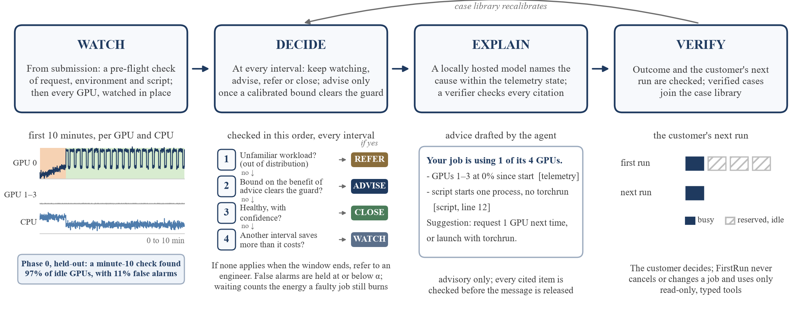
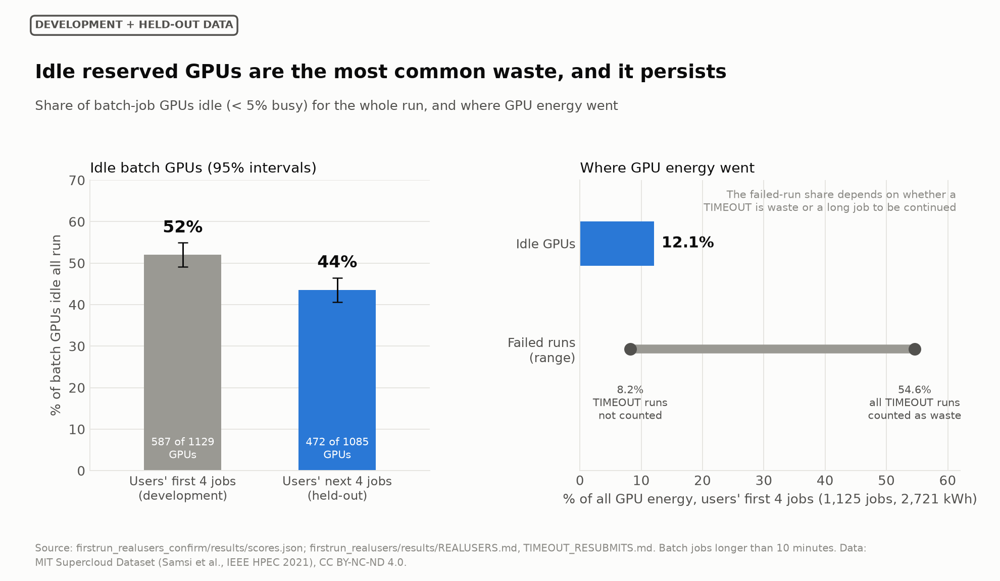
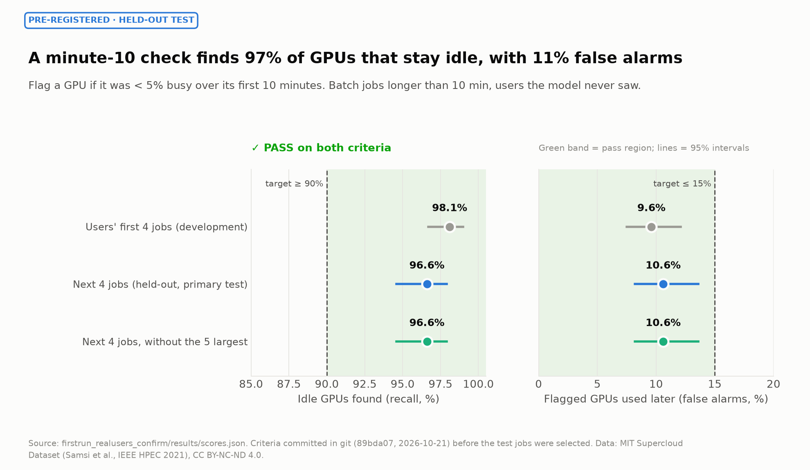
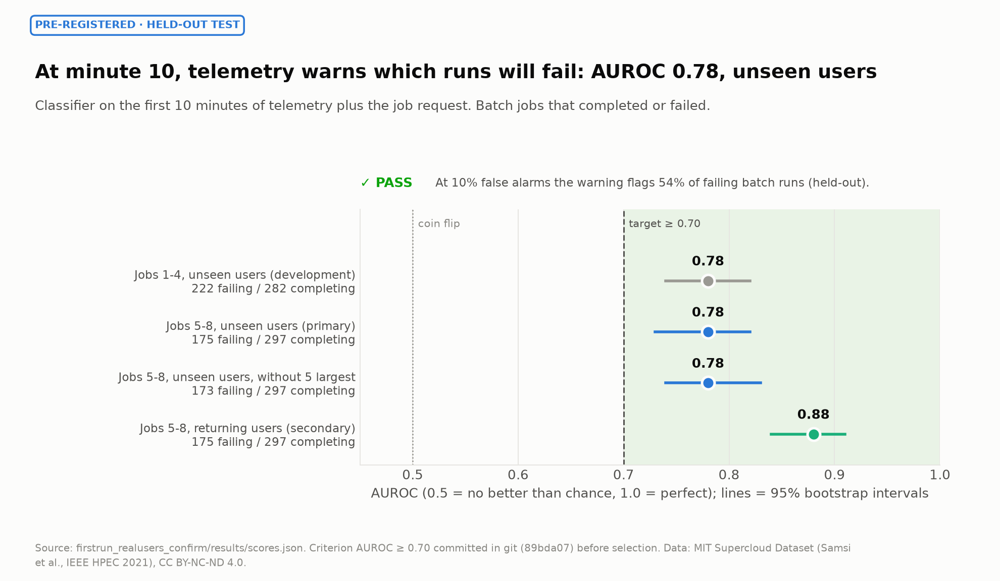
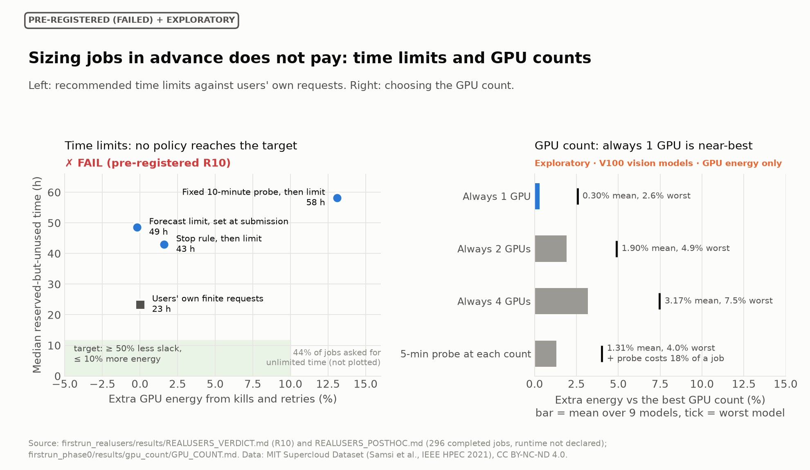
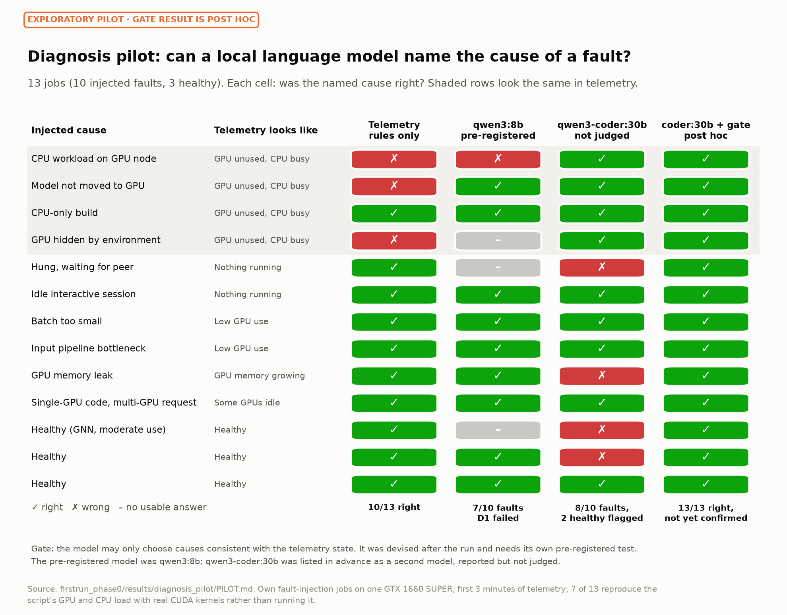
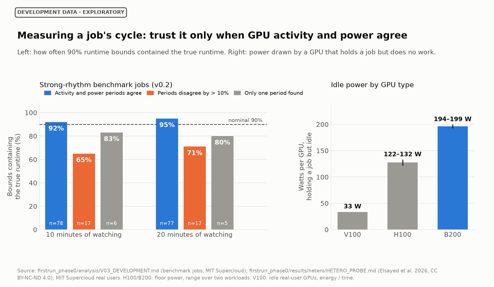

# FirstRun · Phase 0 evidence

Supporting evidence for the Research Ireland Industry Fellowship proposal **"FirstRun: Risk- and Energy-Aware
Agentic Onboarding of New Workloads on a Commercial GPU Supercomputer"** (Dr Tautvydas Lisas, Dr Tania Malik, TU Dublin, with
CloudCIX). 

Phase 0 replayed the FirstRun design **offline on public GPU telemetry**

*The FirstRun loop. Decide checks four actions in order at every interval. The Watch result is from the Phase 0
held-out test; the other lower panels are schematic.*

## How to read this repository

Every figure and claim carries one of three labels. They matter more than any single number.

| Label | Meaning |
|---|---|
| **PRE-REGISTERED · HELD-OUT TEST** | Pass criteria committed to git before the test jobs were selected; scored once on jobs never used in development. The strongest evidence here. |
| **DEVELOPMENT DATA** | Measured on the data the method was built on. Shows what was learned, not what was confirmed. |
| **EXPLORATORY** / **POST HOC** | A pilot or an analysis chosen after looking at the data. Suggestive only; needs its own pre-registered test. |

## The claims

| # | Proposal claim | Result | Evidence | Details |
|---|---|---|---|---|
| C1 | Idle reserved GPUs are the most common waste and persist past users' first runs | 52% of batch GPUs idle all run in users' first 4 jobs; 44% in their next 4 | Development + held-out | [C1](claims/C1_idle_waste.md) |
| C2 | A minute-10 check finds idle GPUs reliably | 96.6% found, 10.6% false alarms (targets ≥ 90%, ≤ 15%): **PASS** | **Pre-registered, held-out** | [C2](claims/C2_minute10_idle_check.md) |
| C3 | Minute 10 warns which runs will fail, for users never seen before | AUROC 0.78 [0.73–0.82] (target ≥ 0.70): **PASS** | **Pre-registered, held-out** | [C3](claims/C3_failure_warning.md) |
| C4 | Sizing jobs in advance does not pay | Time limits: **FAIL** (pre-registered); always-1-GPU within 0.3% of the best count on average | Pre-registered + exploratory | [C4](claims/C4_sizing_does_not_pay.md) |
| C5 | A local model, restricted to telemetry-consistent causes, can name the fault | 13/13 with the gate (post hoc); 8/10 faults without it; the pre-registered model got 7/10 | Exploratory pilot | [C5](claims/C5_diagnosis_pilot.md) |
| C6 | A job's cycle can be trusted when activity and power agree; idle B200s are costly | Bounds held 92–95% when periods agree vs 65–71% when not; idle B200 ≈ 194–199 W | Development, exploratory | [C6](claims/C6_measurement.md) |

What did **not** hold up is listed in [LIMITATIONS.md](LIMITATIONS.md). Methods in brief: [METHODS.md](METHODS.md).
Terms such as AUROC, recall or "held-out" are explained in [GLOSSARY.md](GLOSSARY.md). Pre-registration files and
their commit dates: [preregistration/](preregistration/).

**About the "Source" lines.** Each figure and claim page names the result file a number came from, such as
`firstrun_realusers_confirm/results/scores.json`. Those files are in the author's private analysis workspace, not in
this repository, because the dataset licences do not allow derived tables to be shared. Every number they supply is
copied into [`data/summary.json`](data/summary.json); the full files are available to reviewers on request.

## Figures

| | |
|---|---|
|  |  |
|  |  |
|  |  |

Every figure is drawn by [`make_figures.py`](make_figures.py) from [`data/summary.json`](data/summary.json), which
holds each number used here with the result file it came from. Run `python make_figures.py` to redraw them.

## Data and licences

- **MIT Supercloud Dataset** (Samsi et al., IEEE HPEC 2021, doi:10.1109/HPEC49654.2021.9622850): CC BY-NC-ND 4.0.
  Used for C1–C4 and C6. Only figures and summary numbers appear here; no derived tables are redistributed.
- **Elsayed et al. (2026)**, Scientific Data 13, 1268, doi:10.1038/s41597-026-07496-6: CC BY-NC-ND 4.0. Used for
  H100 and B200 idle power in C6.
- **Fault-injection pilot** (C5): the author's own jobs.

See [DATA_LICENCES.md](DATA_LICENCES.md). The Phase 0 code is available to reviewers on request; its open-source
release will follow the IP agreement between CloudCIX and TU Dublin, as the proposal states.
