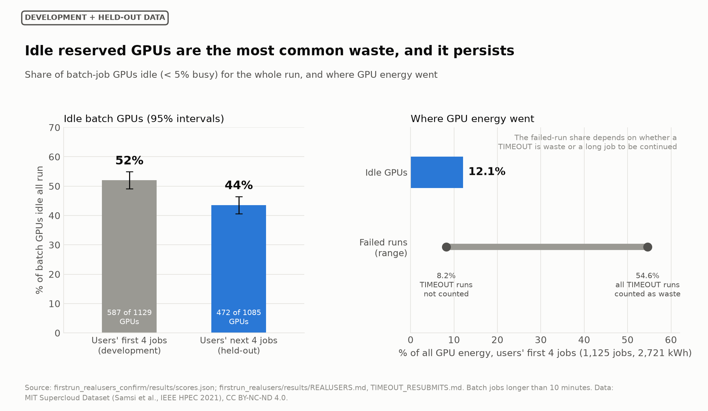

# C1 · Idle reserved GPUs are the largest waste, and it persists

**Evidence:** development data (users' first 4 jobs) + held-out data (their next 4 jobs), both scored with the
same frozen code (v0.3). Not itself a pre-registered criterion.

## Proposal sentence

> Waste shows within a job's first minutes, is worst in a customer's first runs and persists later: in our
> analysis of public data, 52% of batch GPUs sat idle in users' first four jobs and still 44% in the next four.

## Numbers

| | Idle GPUs | All GPUs | Share | 95% interval |
|---|---|---|---|---|
| Users' first 4 jobs (development) | 587 | 1,129 | 52.0% | 49.1–54.9% |
| Users' next 4 jobs (held-out) | 472 | 1,085 | 43.5% | 40.6–46.5% |
| Next 4 jobs, without the 5 largest jobs | 472 | 1,024 | 46.1% | 43.1–49.2% |

Idle = whole-run mean GPU utilisation under 5%. Batch jobs longer than 10 minutes. MIT Supercloud real users,
V100 GPUs, 2021–2022.

Energy, users' first 4 jobs (1,125 jobs, 310 users, 2,721 kWh of GPU energy):

| | Share of GPU energy |
|---|---|
| Idle GPUs (all job types) | 12.1% |
| Failed runs, TIMEOUT runs not counted as waste | 8.2% |
| Failed runs, every TIMEOUT counted as waste | 54.6% |

## How to read it

- **"Largest" holds by how often it happens:** about half of all batch GPUs reserved in users' first jobs did no
  work at all. By energy it depends on TIMEOUT runs (jobs killed at their time limit): three very large TIMEOUT jobs
  from two users carry 39% of all GPU energy, and many TIMEOUTs are long jobs that were continued, not wasted. Idle
  GPUs (12.1%) outweigh failed runs (8.2%) unless most TIMEOUT energy is counted as waste.
- **The 52% is development data**; the 44% is on jobs no analysis had touched. Removing the five largest jobs
  raises the held-out share to 46% (smaller denominator), so the drop from the first jobs is modest either way.
- GPU energy only: host CPU, memory and network power are not in the data.

## Sources

`firstrun_realusers_confirm/results/scores.json` (`development_reference.C1_idle_rule`, `criteria.C1_idle_rule`);
`firstrun_realusers/results/REALUSERS.md` §4; `firstrun_realusers/results/TIMEOUT_RESUBMITS.md`.
