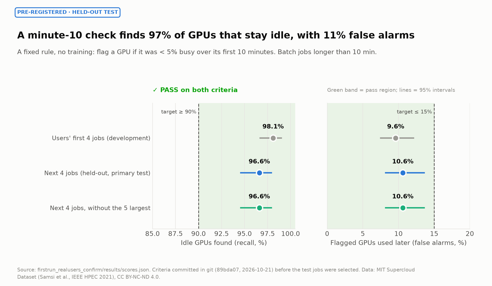

# C2 · A minute-10 check finds the GPUs that stay idle

**Evidence: pre-registered, held-out.** Criterion C1 of
[REALUSER_CONFIRMATION_CRITERIA.md](../preregistration/REALUSER_CONFIRMATION_CRITERIA.md), committed in git
(`89bda07`, 2026-10-21 15:42) before any test job was selected. **Verdict: PASS.**

## Proposal sentence

> On 956 held-out jobs, a minute-10 check found 97% of idle GPUs with 11% false alarms.

## The test

- **Rule:** flag a GPU if its mean utilisation over the first 10 minutes is under 5%. This is a fixed threshold,
  not a trained model, so nothing was fitted to any user's jobs.
- **Truth:** the GPU stays idle (mean utilisation under 5%) for the whole run.
- **Test jobs:** each real user's next 4 GPU jobs (jobs 5–8 by submit time): 956 jobs from 251 users, none used in
  development. Scored on every GPU of a batch job longer than 10 minutes.
- **Pass if** recall ≥ 90% and false alarms ≤ 15%.

The test is whether a rule chosen on users' first jobs still holds on jobs that no analysis had touched.

## Result

| | Recall | False alarms | Idle GPUs / GPUs |
|---|---|---|---|
| Jobs 5–8 (primary) | **96.6%** [94.6–97.9] | **10.6%** [8.2–13.6] | 472 / 1,085 |
| Jobs 5–8 without the 5 largest jobs | 96.6% [94.6–97.9] | 10.6% [8.2–13.6] | 472 / 1,024 |
| Jobs 1–4, same code (development, for comparison) | 98.1% [96.7–99.0] | 9.6% [7.5–12.1] | 587 / 1,129 |

Brackets: Wilson 95% intervals. Secondary check, all job types including interactive sessions: recall 96.5%, false
alarms 11.3% (678 idle of 1,346 GPUs).

## What it means

The energy at stake on the held-out jobs is smaller than in development: GPUs flagged at minute 10 burned 5.8% of
batch GPU energy after minute 10 (10.8% without the 5 largest jobs), against 8.8% (17.9%) on jobs 1–4. Quote
**6–11% of batch GPU energy**. A false alarm is a GPU that was idle for 10 minutes and used later (for example,
long data loading before training), which is why FirstRun only advises and never stops a job.

## Sources

`firstrun_realusers_confirm/results/scores.json`, `REALUSER_CONFIRMATION.md`. Frozen pipeline fingerprint
`d6f22f9ac3d1007c…`; scoring script sha256 `f91be647…`.
