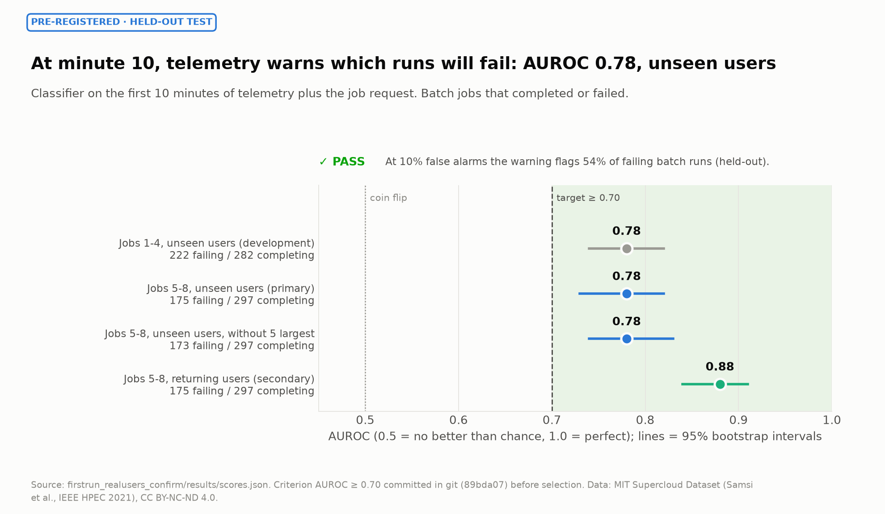

# C3 · At minute 10, telemetry warns which runs will fail

**Evidence: pre-registered, held-out.** Criterion C2 of
[REALUSER_CONFIRMATION_CRITERIA.md](../preregistration/REALUSER_CONFIRMATION_CRITERIA.md), committed in git
(`89bda07`) before selection. **Verdict: PASS.**

## Proposal sentence

> …and a failure warning reached AUROC 0.78 for unseen users.

## The test

- **Inputs:** the job's first 10 minutes of GPU telemetry and its resource request.
- **Outcome:** failed (FAILED, TIMEOUT, OUT_OF_MEMORY or NODE_FAIL) against COMPLETED. CANCELLED jobs are left out.
- **Test jobs:** batch jobs among users' jobs 5–8 that ran longer than 10 minutes: 175 failing, 297 completing.
  Models trained only on other user groups' jobs 1–4.
- **Pass if** AUROC ≥ 0.70.

## Result

| | AUROC | 95% bootstrap interval |
|---|---|---|
| Jobs 5–8, unseen users (primary) | **0.78** | 0.73–0.82 |
| Jobs 5–8, unseen users, without the 5 largest jobs | 0.78 | 0.74–0.83 |
| Jobs 1–4, unseen users (development, same code) | 0.78 | 0.74–0.82 |
| Jobs 5–8, returning users (secondary, not judged) | 0.88 | 0.84–0.91 |

At a 10% false-alarm rate the warning flags 54% of failing batch runs.

## What it means

The warning is useful, not decisive: it ranks a failing run above a completing one 78% of the time. That is why
the proposal pairs it with a calibrated false-alarm threshold (O3) and lets FirstRun refer uncertain cases instead
of advising. Returning users are easier (0.88), because their earlier jobs inform the model.

## Sources

`firstrun_realusers_confirm/results/scores.json` (`criteria.C2_failure_warning`,
`secondary.failure_warning_returning_users`), `REALUSER_CONFIRMATION.md`.
