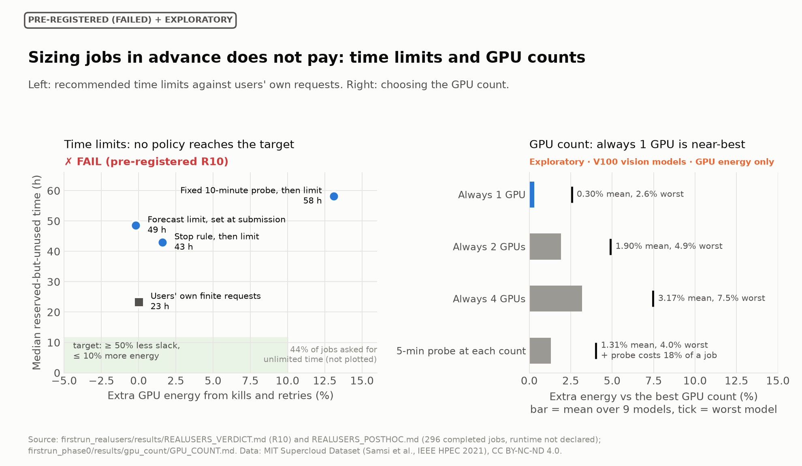

# C4 · Sizing jobs in advance does not pay

**Evidence:** time limits are pre-registered criterion R10 of
[REALUSERS_CRITERIA.md](../preregistration/REALUSERS_CRITERIA.md), **verdict FAIL**; GPU count is exploratory.

## Proposal sentence (revised wording: "on average" added)

> Probing to size for small jobs did not pay: tightened time limits never beat users' requests, and a one-GPU
> default came within 0.3% of the best GPU count on average.

This negative result is why FirstRun moved from sizing jobs before they run to watching and diagnosing them.

## Time limits (pre-registered, FAIL)

**Criterion R10:** some forecast-based policy cuts median reserved-but-unused time by at least 50% compared with
users' own requests, with at most 10% extra energy from kills and retries. Development real users, 296 completed
jobs, runtime not declared in advance.

| Policy | Median unused time | Extra energy |
|---|---|---|
| Users' own finite requests | 23.4 h | 0% |
| Forecast limit, set at submission | 48.6 h | −0.2% |
| Stop rule, then limit | 43.0 h | +1.6% |
| Fixed 10-minute probe, then limit | 58.2 h | +13.1% |

No policy reached the target region. Without a step count, runtime cannot be forecast tightly enough: a safe limit
is wider than what users already ask for. 44% of these jobs asked for unlimited time; against those, any limit
frees reserved time, but the comparison with finite requests is the honest one.

## GPU count (exploratory)

Nine V100 vision models run at 1, 2 and 4 GPUs; extra GPU energy per unit of work compared with the best count.

| Policy | Mean extra energy | Worst model | Picked the best count |
|---|---|---|---|
| Always 1 GPU | **0.30%** | 2.6% | 78% of models |
| Always 2 GPUs | 1.90% | 4.9% | 22% |
| Always 4 GPUs | 3.17% | 7.5% | 0% |
| 5-minute probe at each count | 1.31% | 4.0% | 43% (plus 18% of a job's energy spent probing) |

"Within 0.3%" is the mean over the nine models. GPU energy only: more GPUs finish sooner and would save host energy
that is not measured, so this favours fewer GPUs.

## Sources

`firstrun_realusers/results/REALUSERS_VERDICT.md` (R10), `REALUSERS_POSTHOC.md` §4;
`firstrun_phase0/results/gpu_count/GPU_COUNT.md` §3.
