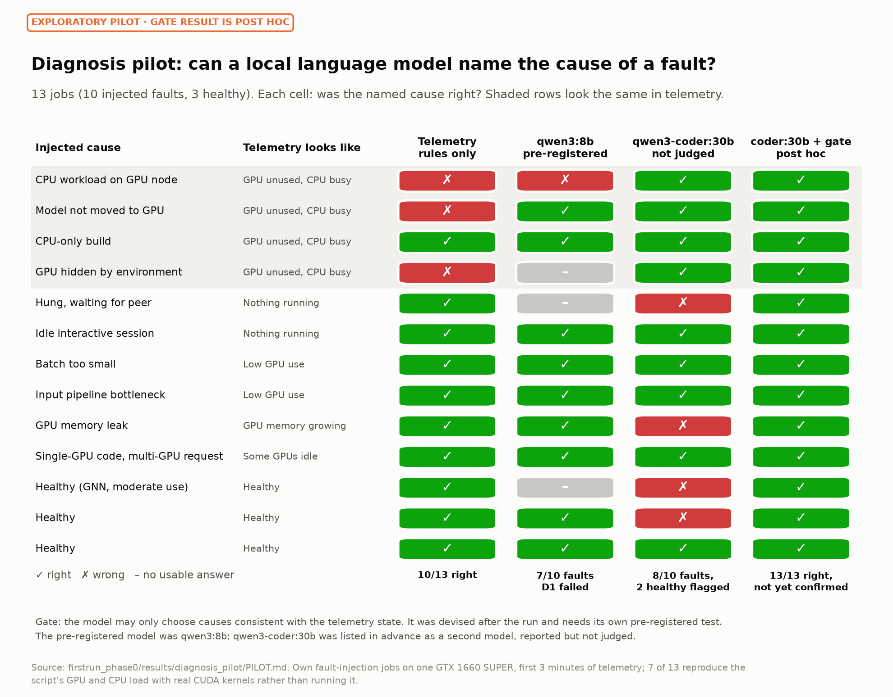

# C5 · Diagnosis pilot: naming the cause of a fault

**Evidence: exploratory pilot.** The 13/13 result uses a rule devised after the run (**post hoc**) and is not
confirmed.

## Proposal sentence

> In a 13-job fault-injection pilot, a local language model that read each job's script, log and telemetry,
> restricted to causes consistent with the telemetry, identified all 13 causes in retrospective analysis (a small
> exploratory test), against 8 of 10 faulty jobs and two false alarms unrestricted; telemetry-only rules got 10 of
> 13, missing three causes that look the same in telemetry.

## Setup

- 13 jobs on one GTX 1660 SUPER: 10 with one injected fault each, 3 healthy controls; first 3 minutes of telemetry.
- 5 jobs ran their script for real; 7 reproduced the script's GPU and CPU load with real CUDA kernels and printed
  generated log lines; 1 was an idle interactive session.
- The model saw the submission, the script with line numbers, the log and numbered telemetry facts, and had to pick
  one cause from a closed list, cite evidence and write a message. A verifier accepted a diagnosis only if every
  cited item existed.
- Criteria were written before recording ([CRITERIA](../preregistration/diagnosis_pilot_CRITERIA.md)), but this file
  was **not committed to git**, so its timing rests on file dates only.

## Results

| | Faulty jobs right | Healthy jobs given a fault | Overall |
|---|---|---|---|
| Telemetry rules only | 7/10 | 0/3 | 10/13 |
| **qwen3:8b** (the pre-registered model) | 7/10 | 0/3 (1 no answer) | 9/13 · D1–D4 all FAIL |
| qwen3-coder:30b (listed in advance, reported but not judged) | 8/10 | 2/3 | 9/13 |
| qwen3-coder:30b + telemetry gate (post hoc) | 10/10 | 0/3 | **13/13** |
| qwen3:8b + telemetry gate (post hoc) | 8/10 | 0/3 | 11/13 |

The telemetry gate lets the model choose only among causes consistent with the job state that the telemetry rules
see; otherwise the rule's answer stands. The rules alone cannot separate the four "GPU unused, CPU busy" causes
(shaded rows), because their telemetry is the same; reading the script and log is what resolves them.

## What it means, and what it does not

- Reading the script and log adds information that telemetry cannot: the larger model named all four look-alike
  causes, where the rules got one.
- The pilot is small, on one consumer GPU, partly emulated, and its best result was found after the fact. The
  proposal's O4 target (≥ 80% correct with ≤ 10% false diagnoses on an open benchmark) is the real test.

## Source

`firstrun_phase0/results/diagnosis_pilot/PILOT.md`.
