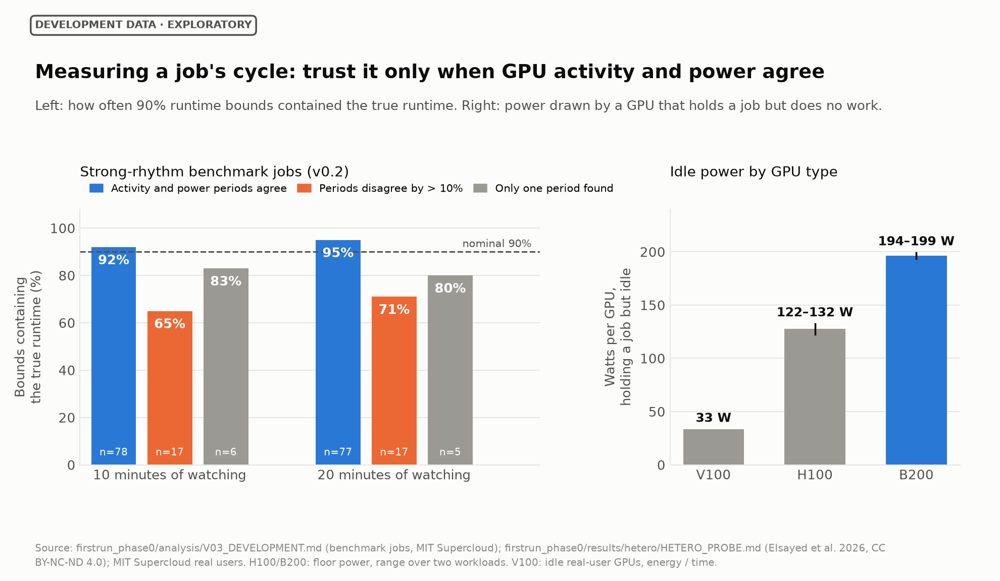

# C6 · Measuring a job's cycle, and what an idle GPU costs

**Evidence:** development data (period check) and exploratory analysis (idle power). Neither is a pre-registered
held-out test.

## Proposal sentences (first one in revised wording: 65–71%, not 65–75%)

> …trusts a cycle only when activity and power agree; in Phase 0, estimates then contained the true value 92–95% of
> the time, against 65–71% when they disagreed.

> An idle B200 is not cheap: one holding a job but doing no work drew about 195 W in our analysis of public traces,
> six times a V100's 33 W.

## Period agreement (development)

FirstRun estimates a training job's repeating cycle (one step or epoch) from the autocorrelation of GPU activity
and, separately, of GPU power. On benchmark jobs with a strong rhythm, 90% runtime bounds were checked against the
true runtime:

| Watching | Periods | Jobs | Bounds containing the truth |
|---|---|---|---|
| 10 min | agree within 10% | 78 | 92% |
| 10 min | disagree by more than 10% | 17 | 65% |
| 10 min | only one found | 6 | 83% |
| 20 min | agree within 10% | 77 | 95% |
| 20 min | disagree by more than 10% | 17 | 71% |
| 20 min | only one found | 5 | 80% |

Most disagreements are harmonics (one signal locks onto half or double the true cycle). This was found after the
v0.2 benchmark confirmation fell short (74% coverage against an 85% target) and became the v0.3 rule. It is
development evidence: no untouched labelled benchmark jobs remained to confirm it, and on real users the strong
tier was too small to test (see [LIMITATIONS.md](../LIMITATIONS.md)).

## Idle power (exploratory)

| GPU | Watts per GPU, holding a job but idle | Measure | Data |
|---|---|---|---|
| V100 | 33 W | idle real-user GPUs: total energy ÷ total time (964 GPUs; per-GPU median 28 W) | MIT Supercloud |
| H100 | 122–132 W | floor power (1st percentile of 1-s power), median per workload | Elsayed et al. 2026 |
| B200 | 194–199 W | floor power, median per workload | Elsayed et al. 2026 |

Worked example from the proposal: an 8-GPU job whose code uses one GPU leaves seven B200s idle, about 7 × 195 W ≈
1.4 kW. Caught at minute 10 instead of at a 48-hour limit, that is up to 7 × 47.8 h ≈ 335 GPU-hours and about 65 kWh.

## Sources

`firstrun_phase0/analysis/V03_DEVELOPMENT.md`; `firstrun_phase0/results/hetero/HETERO_PROBE.md`; V100 value
computed from the real-user per-GPU table (2026-11-14).
